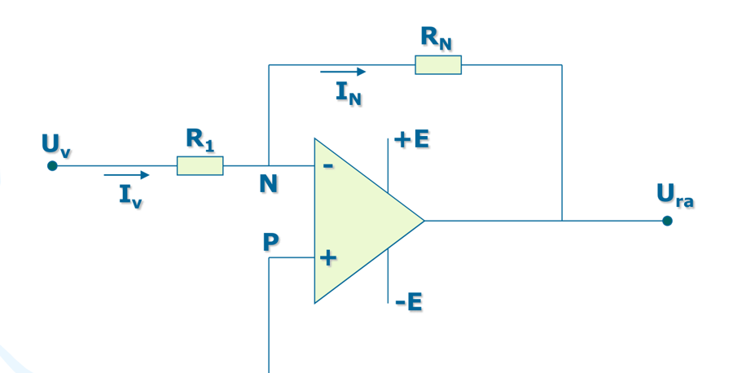
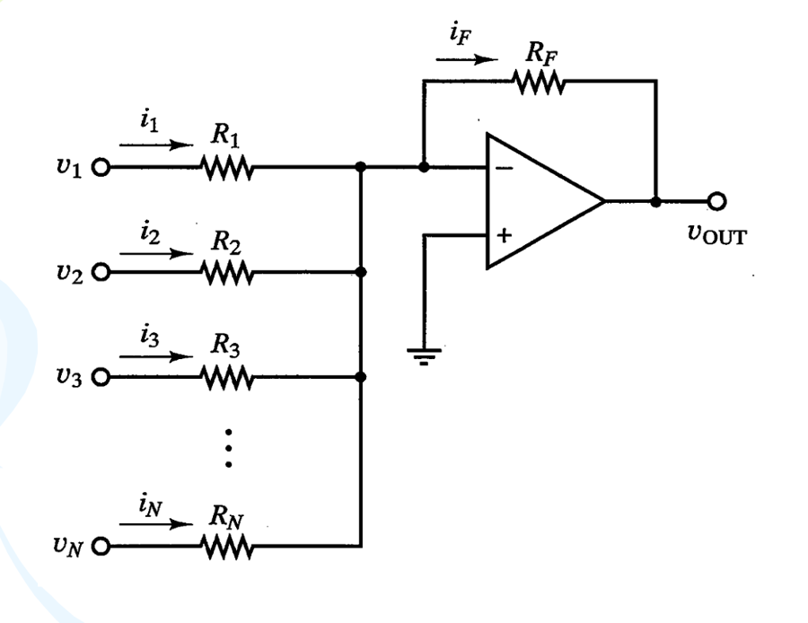
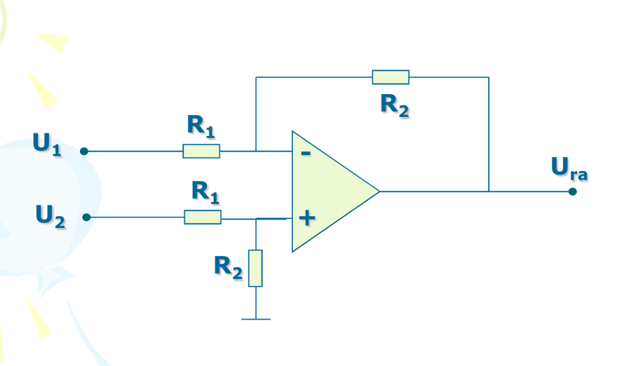
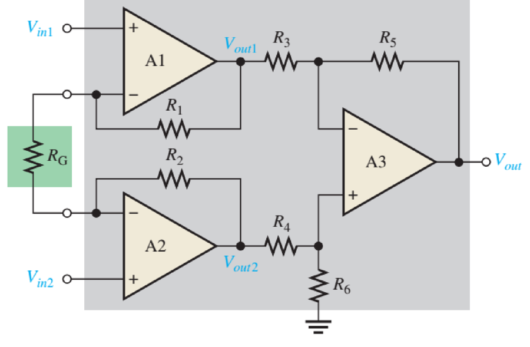
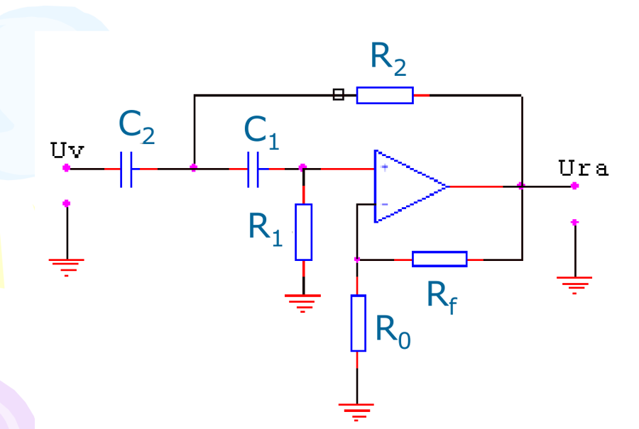
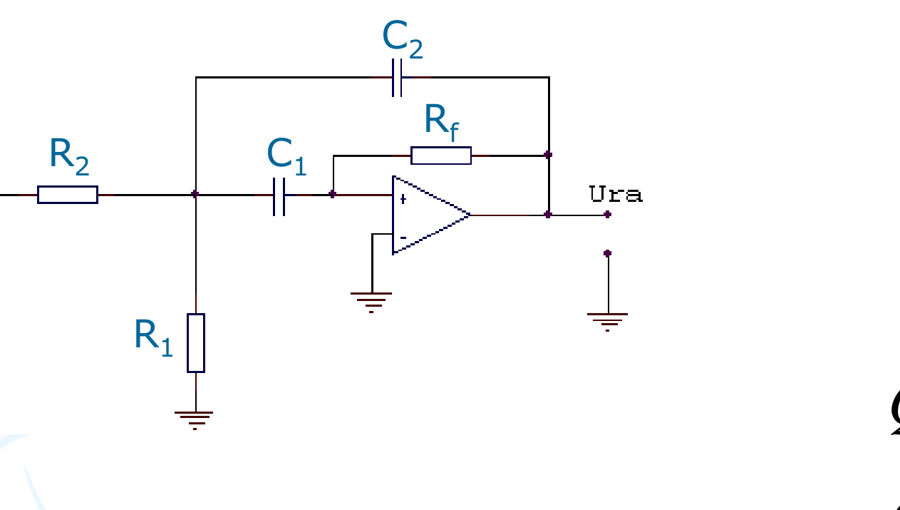
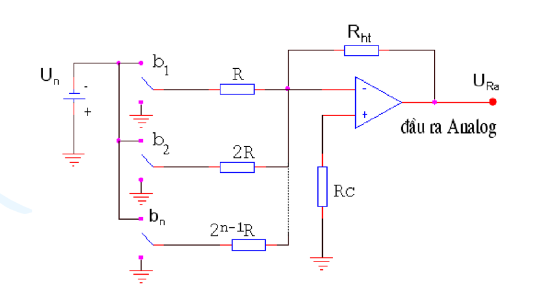

# Signals, noise and electrodes

## Which of these biosignals usually has the smallest amplitude? {type=single id=sig-smallest tags=signals}

- [ ] ECG
- [ ] EMG
- [x] EEG
- [ ] EOG

::: explanation
EEG is about 2–200 µV, the smallest of the four. ECG reaches about 5 mV, EMG 20–500 µV and EOG up to about 2 mV. This is why EEG amplifiers need the highest gain and the lowest noise. Source: 2018 Ch.1 p15; 2026 V.3.
:::

## Lead I reads 0.6 mV and lead III reads 0.9 mV at the same instant. What does lead II read? {type=single id=sig-einthoven tags=signals}

- [ ] 0.3 mV
- [x] 1.5 mV
- [ ] 0.75 mV
- [ ] 1.08 mV

::: explanation
Einthoven's law: II = I + III = 0.6 + 0.9 = 1.5 mV. It holds because the three limb leads form a closed loop (RA, LA, LF), so their voltages must add up. A common slip is subtracting (0.3 mV). 0.75 mV is the average and 1.08 mV adds the leads as if they were noise powers. Source: 2018 Ch.1, ECG leads.
:::

## An ECG has an RMS amplitude of 2 mV and the noise has an RMS amplitude of 20 µV. What is the SNR? {type=single id=noise-snr tags=noise}

- [ ] 20 dB
- [x] 40 dB
- [ ] 80 dB
- [ ] 100 dB

::: explanation
The voltage ratio is 2 mV / 20 µV = 100. For voltages SNR = 20·log10(100) = 40 dB. 20 dB comes from wrongly using 10·log on a voltage ratio. 80 dB doubles the log twice, and 100 dB treats the ratio as if it were already in dB. Source: 2026 I.9–I.10.
:::

## Twisted-pair electrode leads mainly reduce which kind of interference coupling? {type=single id=noise-twisted tags=noise}

- [ ] Capacitive coupling from a large dU/dt
- [ ] Conduction through a shared supply
- [x] Inductive coupling from a large dI/dt
- [ ] Thermal noise of the lead resistance

::: explanation
Twisting makes the loop area small, and neighbouring twists pick up opposite induced voltages that cancel. That defeats magnetic (inductive) coupling, which comes from a changing current. Capacitive coupling is fought with shielding and spacing, conducted noise with filtering and isolation. Thermal noise is generated inside the resistance and no wiring trick removes it. Source: 2026 I.11–I.13.
:::

## Two uncorrelated noise sources of 6 µV RMS and 8 µV RMS add at the amplifier input. What is the total noise? {type=single id=noise-add tags=noise}

- [ ] 14 µV
- [ ] 7 µV
- [x] 10 µV
- [ ] 2 µV

::: explanation
Uncorrelated noise adds in power, not in voltage: √(6² + 8²) = √100 = 10 µV. Adding the voltages directly (14 µV) is the usual mistake. 7 µV is the average and 2 µV the difference. Source: Northrop 9.2.
:::

## The half-cell potential at an electrode mainly causes which problem for the amplifier? {type=single id=elec-halfcell tags=electrodes}

- [x] A DC offset (up to about ±300 mV) that limits the first-stage gain
- [ ] A 50 Hz hum that a notch filter must remove
- [ ] High-frequency noise above the ECG band
- [ ] A loss of CMRR inside the op-amp itself

::: explanation
The metal–electrolyte interface creates a nearly constant half-cell voltage, so it appears as a DC offset, up to ±300 mV in the ECG spec. A high-gain first stage would saturate on it, so the first gain is kept modest and a high-pass at about 0.05 Hz (AC coupling) removes it. 50 Hz hum comes from the mains, not from the electrode chemistry. Source: 2026 I.3–I.7, V.3.
:::

## Why is Ag/AgCl the standard material for biopotential electrodes? {type=single id=elec-agcl tags=electrodes}

- [ ] It has the highest possible half-cell potential, so the signal is larger
- [ ] It needs no gel, so it can be used dry on the skin
- [x] It has a low, stable half-cell potential and low noise
- [ ] It blocks DC completely, so no high-pass filter is needed

::: explanation
Ag/AgCl gives a small, stable half-cell potential with low noise and little motion artifact, so the DC offset and drift are small. A large half-cell potential would be a disadvantage, since it does not enlarge the biosignal. Standard Ag/AgCl electrodes use gel, and the DC offset is still removed by AC coupling. Source: 2026 I.3–I.7; Northrop 1.8.
:::

# Op-amp fundamentals

## With negative feedback, which two rules let us analyse an ideal op-amp circuit? {type=single id=op-golden tags=opamp}

- [ ] Output current is zero, and output voltage equals the supply
- [x] Input currents are zero, and the two input voltages are equal
- [ ] Input voltages are zero, and the input currents are equal
- [ ] Gain equals one, and output impedance is infinite

::: explanation
Ideal input impedance is infinite, so I_P = I_N = 0. Negative feedback forces U_P = U_N (the "virtual short"), because any difference would be multiplied by a huge K. The other options mix up which quantity is zero. The output can deliver current, and its ideal impedance is zero, not infinite. Source: 2026 V.12; 2018 Ch.2 p54–57.
:::

## An amplifier has differential gain $K_d = 2000$ and common-mode gain $K_c = 0.02$. What is its CMRR? {type=single id=op-cmrr-calc tags=cmrr}

- [ ] 50 dB
- [ ] 66 dB
- [ ] 200 dB
- [x] 100 dB

::: explanation
CMRR = K_d / K_c = 2000 / 0.02 = 10⁵. In dB it is 20·log10(10⁵) = 100 dB. 50 dB uses 10·log instead of 20·log. 66 dB is 20·log of K_d alone, ignoring K_c. 200 dB doubles the exponent. Source: 2026 V.13–V.15.
:::

## In an ECG amplifier, what does a high CMRR achieve? {type=single id=op-cmrr-meaning tags=cmrr}

- [ ] It amplifies the ECG more than a low-CMRR amplifier would
- [x] It rejects the 50 Hz voltage that appears equally on both electrodes
- [ ] It removes the DC offset of each electrode separately
- [ ] It raises the bandwidth of the amplifier

::: explanation
Mains hum couples into the whole body, so it shows up as the same voltage on both inputs: a common-mode signal. The ECG is the difference between the electrodes. A high CMRR amplifies the difference and rejects the common part. CMRR is a ratio of gains, not a gain or a bandwidth. The electrode offsets differ between electrodes, so they are partly differential and need AC coupling. Source: 2026 V.13–V.15, V.19.
:::

## An op-amp has a gain–bandwidth product of 1 MHz. It is wired with a closed-loop gain of 50. What is the bandwidth? {type=single id=op-gbw tags=opamp}

- [ ] 50 MHz
- [ ] 1 MHz
- [ ] 200 kHz
- [x] 20 kHz

::: explanation
GBW = gain × bandwidth is constant, so bandwidth = 1 MHz / 50 = 20 kHz. Higher closed-loop gain means less bandwidth. 50 MHz multiplies instead of dividing. Source: 2026 V.17; Northrop 6.2.
:::

## An op-amp has a slew rate of 0.5 V/µs. What is the highest frequency of a 5 V peak sine it can output without distortion? {type=single id=op-slew tags=opamp}

- [x] 15.9 kHz
- [ ] 100 kHz
- [ ] 79.6 kHz
- [ ] 1.59 kHz

::: explanation
f_max = SR / (2π·V_p) = 0.5×10⁶ V/s / (2π·5 V) ≈ 15.9 kHz. Above it the output cannot follow the sine and it becomes a triangle wave. A larger amplitude lowers f_max. 100 kHz forgets the 2π, and 79.6 kHz ignores the amplitude. Source: 2026 V.20–V.22.
:::

## The two input currents of an op-amp are 80 nA and 100 nA. What are the input bias current and the input offset current? {type=single id=op-bias tags=opamp}

- [x] Bias 90 nA, offset 20 nA
- [ ] Bias 180 nA, offset 20 nA
- [ ] Bias 20 nA, offset 90 nA
- [ ] Bias 100 nA, offset 80 nA

::: explanation
Bias current is the average, (80 + 100)/2 = 90 nA. Offset current is the difference, |80 − 100| = 20 nA. 180 nA is the sum, not the average. The third option swaps the two definitions. Source: 2026 V.20; 2018 Ch.2.
:::

## An inverting amplifier has $R_i$ = 10 kΩ and $R_f$ = 40 kΩ. What compensation resistor $R_c$ at the + input cancels the bias-current error? {type=single id=op-rc tags=opamp}

- [ ] 50 kΩ
- [x] 8 kΩ
- [ ] 40 kΩ
- [ ] 10 kΩ

::: explanation
R_c = R_i ∥ R_f = (10 × 40)/(10 + 40) = 8 kΩ. Then both inputs see the same resistance, so the voltages the bias currents create cancel and only the much smaller offset current remains. Using R_i + R_f (50 kΩ) is the common slip. 40 kΩ and 10 kΩ use only one of the two resistors. Source: 2026 V.27–V.29.
:::

## What does negative feedback do to an op-amp amplifier's gain and bandwidth? {type=single id=op-negfb tags=opamp}

- [ ] It raises the gain and narrows the bandwidth
- [ ] It lowers the gain and narrows the bandwidth
- [x] It lowers the gain and widens the bandwidth
- [ ] It raises the gain and widens the bandwidth

::: explanation
Negative feedback subtracts part of the output from the input. The gain drops from the huge open-loop value to a precise value set by resistors, and because gain × bandwidth is constant (GBW), the bandwidth widens. It also makes the circuit stable and linear. Raising the gain or causing oscillation are signs of positive feedback. Source: 2026 V.23–V.24.
:::

# Op-amp circuits

## Identify this circuit. {type=single id=circ-id-inverting tags=opamp-circuits}

- [ ] Non-inverting amplifier
- [ ] Voltage follower
- [x] Inverting amplifier
- [ ] Integrator

::: explanation
The input enters the − input through R1, the feedback resistor runs from the output to the same − input, and + is grounded. That is the inverting amplifier, U_out = −(R_N/R_1)·U_in. A non-inverting amplifier feeds the signal into +. A follower has no resistors, and an integrator has a capacitor in the feedback. Source: 2018 Ch.2 p67; 2026 V.26.
:::

## Identify this circuit. {type=single id=circ-id-summing tags=opamp-circuits}

- [x] Summing (adder) amplifier
- [ ] Difference amplifier
- [ ] Weighted-resistor DAC with switches
- [ ] Instrumentation amplifier

::: explanation
Several inputs, each through its own resistor, meet at the − input (a virtual ground), with one feedback resistor. This is the inverting summing amplifier, U_out = −R_F(U_1/R_1 + U_2/R_2 + …). A difference amplifier has one input at − and one at +. A weighted DAC is built from this circuit but has switched reference inputs. Source: 2018 Ch.2 p70.
:::

## Identify this circuit. {type=single id=circ-id-difference tags=opamp-circuits}

- [ ] Summing amplifier
- [x] Difference amplifier
- [ ] Instrumentation amplifier
- [ ] Non-inverting amplifier

::: explanation
One input goes to −, the other to + through a matching divider. Its output is (R_2/R_1)(U_2 − U_1). Unlike an instrumentation amplifier it has only one op-amp and no input buffers, so its input impedance is low. Source: 2018 Ch.2 p74; 2026 V.35.
:::

## A non-inverting amplifier has $R_f$ = 40 kΩ and $R_i$ = 10 kΩ. The input is 20 mV. What is the output? {type=single id=circ-noninv tags=opamp-circuits}

- [ ] 80 mV
- [ ] −80 mV
- [ ] 120 mV
- [x] 100 mV

::: explanation
Gain = 1 + R_f/R_i = 1 + 4 = 5, so 20 mV × 5 = 100 mV. Using only R_f/R_i (gain 4, 80 mV) is the inverting-amplifier formula without the sign. A non-inverting gain can never be below 1. 120 mV would need a gain of 6. Source: 2026 V.25.
:::

## An inverting amplifier has $R_f$ = 100 kΩ and $R_i$ = 20 kΩ. The input is +0.3 V. What is the output? {type=single id=circ-inv tags=opamp-circuits}

- [ ] +1.5 V
- [ ] −1.8 V
- [x] −1.5 V
- [ ] +1.8 V

::: explanation
Gain = −R_f/R_i = −5, so U_out = −5 × 0.3 = −1.5 V. +1.5 V forgets the inversion. ±1.8 V uses the non-inverting gain 1 + R_f/R_i = 6. Source: 2026 V.26.
:::

## A summing amplifier has all resistors equal to 10 kΩ. The inputs are +0.5 V, −0.2 V and +0.1 V. What is the output? {type=single id=circ-sum tags=opamp-circuits}

- [x] −0.4 V
- [ ] +0.4 V
- [ ] −0.8 V
- [ ] −0.2 V

::: explanation
With equal resistors U_out = −(U_1 + U_2 + U_3) = −(0.5 − 0.2 + 0.1) = −0.4 V. The minus sign comes from the inverting structure. The inputs do not disturb each other because they meet at a virtual ground. −0.8 V ignores the sign of the −0.2 V input. Source: 2018 Ch.2 p70.
:::

## What is the main job of a voltage follower (buffer) placed right after an electrode? {type=single id=circ-buffer tags=opamp-circuits}

- [ ] To amplify the ECG by a factor of about 10
- [ ] To invert the signal so the next stage can subtract it
- [ ] To remove the DC offset of the electrode
- [x] To present a very high input impedance and a low output impedance

::: explanation
A follower has gain 1. It is an impedance converter: it draws almost no current from the high-impedance electrode and drives the next stage from a low output impedance. It does not amplify, invert or block DC. Source: 2026 V.38; Northrop 6.1.
:::

## Why does a plain op-amp integrator (only C in the feedback) drift into saturation, and what is the usual fix? {type=single id=circ-integrator tags=opamp-circuits}

- [x] Its DC gain is unlimited, so offsets are integrated; add $R_f$ in parallel with C
- [ ] Its input impedance is too low; add a buffer before R
- [ ] Its high-frequency gain is unlimited; add a small R in series with C
- [ ] Its output impedance is too high; add a follower after it

::: explanation
At DC the capacitor is an open circuit, so the gain is unlimited. Any offset voltage or bias current is integrated over time until the output hits the rail. A resistor across C limits the DC gain, turning the circuit into a 1-pole low-pass. A series R with C is the fix for the differentiator, whose problem is unlimited high-frequency gain. Source: Northrop 6.1; 2018 Ch.2 p66.
:::

# Comparators, bio-amplifiers and safety

## How is an op-amp connected when it works as a comparator? {type=single id=cmp-basic tags=comparator}

- [ ] With negative feedback, so U_P = U_N
- [ ] As a voltage follower with the reference on the output
- [x] Open loop (no negative feedback), so the output saturates at a rail
- [ ] With a capacitor in the feedback path

::: explanation
A comparator uses no negative feedback. The huge open-loop gain drives the output to +V_sat when U_in > U_ref and to −V_sat otherwise, which gives a digital-like answer. The virtual-short rule only applies with negative feedback. A capacitor in the feedback makes an integrator. Source: Northrop 6.5; 2026 V.23.
:::

## A Schmitt trigger feeds back $R_1/(R_1+R_2)$ of its output to the + input, with $R_1$ = 10 kΩ, $R_2$ = 90 kΩ and $V_{sat}$ = ±10 V. What is the hysteresis width ΔU? {type=single id=cmp-schmitt tags=comparator}

- [ ] 1 V
- [x] 2 V
- [ ] 18 V
- [ ] 0.2 V

::: explanation
The thresholds are ±R_1/(R_1+R_2)·V_sat = ±0.1 × 10 = ±1 V, so ΔU = 2 V. Noise smaller than 2 V near the threshold can no longer make the output chatter. A signal smaller than ΔU is never detected. 1 V is only one threshold, and 18 V uses R_2 instead of R_1. Source: Northrop 6.5.
:::

## How does a comparator circuit detect a lead-off (floating) ECG electrode? {type=single id=cmp-leadoff tags=comparator}

- [ ] The electrode's half-cell potential disappears, so the comparator sees 0 V
- [x] A large pull-up drags the unattached input toward a rail, past the comparator threshold
- [ ] The 50 Hz hum disappears when the electrode is off, so the comparator stops toggling
- [ ] The comparator measures the electrode current and trips when it rises

::: explanation
Each input is biased through a very large resistor (or a tiny current) toward a rail. While the electrode is attached, the low body impedance holds the input near mid-supply. When it falls off, nothing holds the input, so it drifts to the rail and crosses the threshold, and the monitor shows "LEAD OFF". A floating input usually picks up more hum, not less. Source: class notes; Northrop 6.5.
:::

## Identify this circuit and how its gain is usually set. {type=single id=ia-id tags=ia}

- [ ] Difference amplifier; gain set by changing R5 and R6 together
- [ ] Summing amplifier; gain set by R3 and R4
- [ ] Isolation amplifier; gain set by the barrier
- [x] Instrumentation amplifier; gain set by the single resistor $R_G$

::: explanation
Two non-inverting stages (A1, A2) buffer both inputs, and a difference stage (A3) subtracts them: this is the 3-op-amp instrumentation amplifier. Its gain is (1 + 2R_1/R_G)(R_5/R_3), so changing one resistor, R_G, changes the gain. A smaller R_G gives a higher gain. Source: 2026 V.42–V.43.
:::

## A 3-op-amp instrumentation amplifier has $R_1 = R_2$ = 20 kΩ, $R_G$ = 2 kΩ, $R_3 = R_4$ = 10 kΩ and $R_5 = R_6$ = 20 kΩ. What is its gain? {type=single id=ia-gain tags=ia}

- [ ] 21
- [ ] 22
- [x] 42
- [ ] 84

::: explanation
K = (1 + 2R_1/R_G)(R_5/R_3) = (1 + 40/2)(20/10) = 21 × 2 = 42. Forgetting the difference stage gives 21. Forgetting the 2 in 2R_1 gives 11 × 2 = 22. 84 uses 4R_1 instead of 2R_1. Source: 2026 V.43.
:::

## What does a right-leg drive (DRL) circuit do in an ECG front end? {type=single id=ia-drl tags=ia}

- [ ] It grounds the right leg directly to the chassis for safety
- [ ] It injects a test current to check whether the electrodes are attached
- [x] It senses the common-mode voltage, inverts it, and drives it back into the body
- [ ] It supplies the isolated power for the patient-side amplifier

::: explanation
The DRL senses the common-mode voltage (mostly 50 Hz) at the midpoint of R_G, inverts and amplifies it, and feeds it back through the right-leg electrode. That cancels the body's common mode and raises the effective CMRR. A series resistor limits the current for safety. Grounding the patient directly would be unsafe. Source: Northrop Ch.3, Ch.8.
:::

## Why is the patient leakage-current limit (10–50 µA) so much tighter than the chassis limit? {type=single id=safe-micro tags=safety}

- [x] Through catheters or pacemaker leads, about 10 µA can reach the heart directly (microshock)
- [ ] Patients can feel currents of a few microamps on the skin
- [ ] Currents in the patient leads would add noise to the ECG
- [ ] Leakage at 10 kHz is more dangerous than at 50–60 Hz

::: explanation
In a microshock, current reaches the heart directly, and about 10 µA can cause ventricular fibrillation. In a macroshock through the skin only a fraction reaches the heart, so much larger currents are needed. Perception starts around 1 mA, not microamps. 50–60 Hz is the most dangerous frequency, and 10 kHz needs much more current for the same effect. Source: 2018 Ch.3 p86–88; Northrop 8.4.
:::

## In an isolation amplifier, which block comes directly before the isolation barrier? {type=single id=safe-iso-chain tags=safety}

- [ ] Demodulator
- [x] Modulator
- [ ] Output amplifier
- [ ] Notch filter

::: explanation
The chain is input amplifier → modulator → isolation barrier → demodulator → output amplifier. The signal must be modulated (onto light, a magnetic carrier or a capacitive link) before it can cross the barrier, and it is demodulated on the far side. No conductive path joins the two sides, so leakage stays below the limits. A notch filter is not part of the isolation chain. Source: 2018 Ch.3 p89–95; Northrop 8.3.
:::

# Analog filters

## The cutoff frequency $f_c$ of a filter is defined where the output has fallen by how much from the passband? {type=single id=filt-fc tags=filters}

- [ ] −6 dB (half the voltage)
- [ ] −20 dB (one tenth of the voltage)
- [ ] −1 dB (the ripple limit)
- [x] −3 dB (0.707 of the voltage, half the power)

::: explanation
f_c is the −3 dB point: the voltage is 1/√2 ≈ 0.707 of the passband value and the power is half. −6 dB is half the voltage, a common confusion. −20 dB is the drop one decade past a 1-pole cutoff. Source: 2018 Ch.4 p5; AD 8.1.
:::

## A passive RC low-pass has R = 10 kΩ and C = 47 nF. What is its cutoff frequency? {type=single id=filt-rc tags=filters}

- [ ] 2.13 kHz
- [ ] 33.9 Hz
- [ ] 3.39 kHz
- [x] 339 Hz

::: explanation
f_c = 1/(2πRC) = 1/(2π × 10⁴ × 47×10⁻⁹) ≈ 339 Hz. Forgetting the 2π gives about 2.1 kHz. 33.9 Hz and 3.39 kHz are off by a factor of ten. Source: 2018 Ch.4 p8–10.
:::

## A 2nd-order Butterworth low-pass has $f_c$ = 200 Hz. About how much does it attenuate a 2 kHz signal? {type=single id=filt-rolloff tags=filters}

- [ ] −20 dB
- [x] −40 dB
- [ ] −6 dB
- [ ] −12 dB

::: explanation
Each pole adds −20 dB/decade, so a 2nd-order filter rolls off at −40 dB/decade. 2 kHz is one decade above 200 Hz, so the attenuation is about −40 dB (×0.01). −20 dB is the 1-pole value. −6 and −12 dB are the per-octave slopes for 1 and 2 poles. Source: 2018 Ch.4 p2–7.
:::

## How is a band-stop (notch) filter built from a low-pass and a high-pass? {type=single id=filt-bandstop tags=filters}

- [ ] In series, with $f_c$(LP) > $f_c$(HP)
- [ ] In series, with $f_c$(HP) > $f_c$(LP)
- [x] In parallel with outputs summed, with $f_c$(HP) > $f_c$(LP)
- [ ] In parallel with outputs subtracted, with $f_c$(LP) > $f_c$(HP)

::: explanation
For band-stop, the LP passes everything below its cutoff and the HP everything above its own, higher cutoff. Summing them leaves out the gap between, which is the stop band. In series (LP then HP, with f_c(LP) > f_c(HP)) you get a band-pass instead. Source: 2018 Ch.4 p20–29.
:::

## Which filter approximation has a linear phase, so it keeps the shape of pulses such as the ECG ST segment? {type=single id=filt-approx tags=filters}

- [ ] Butterworth
- [ ] Chebyshev
- [x] Bessel
- [ ] Elliptic

::: explanation
Bessel has the slowest roll-off but a linear phase (constant delay), so all frequencies are delayed equally and pulse shapes are kept. Butterworth is maximally flat but overshoots a little. Chebyshev and elliptic filters have ripple and ring on pulses. Source: 2018 Ch.4 p30–33; AD 8.4.
:::

## Identify this filter. {type=single id=filt-id-sk tags=filters}

- [ ] 2-pole low-pass (Sallen-Key)
- [ ] 1-pole high-pass (inverting)
- [ ] Multiple-feedback band-pass
- [x] 2-pole high-pass (Sallen-Key)

::: explanation
The input passes through two series capacitors, which block low frequencies. The middle node returns to the output through a resistor (positive feedback), and R_f/R_0 set a non-inverting gain. That is a Sallen-Key 2-pole high-pass, −40 dB/decade below f_c. The low-pass version swaps R and C. An MFB filter feeds the inverting input. Source: 2018 Ch.4 p18.
:::

## A Sallen-Key low-pass uses equal resistors and equal capacitors. Which non-inverting gain K gives a Butterworth response? {type=single id=filt-sk-k tags=filters}

- [ ] K = 1
- [x] K = 1.586
- [ ] K = 2
- [ ] K = 3

::: explanation
With equal parts, Q = 1/(3 − K). Butterworth needs Q = 0.707, so K = 3 − 1.414 = 1.586. K = 1 gives Q = 0.5 (more like Bessel). K = 2 gives Q = 1 (peaking, Chebyshev-like). K = 3 makes Q infinite, and the filter oscillates. Source: 2018 Ch.4 p34–37; AD 8.6.
:::

## Identify this filter. {type=single id=filt-id-mfb tags=filters}

- [x] Multiple-feedback (MFB) band-pass
- [ ] Sallen-Key 2-pole low-pass
- [ ] Twin-T notch
- [ ] Inverting integrator

::: explanation
The circuit drives the inverting input and has two feedback paths (C2 and R_f), so it is a multiple-feedback topology. C1 in series blocks low frequencies and C2 shorts high frequencies, leaving a band around f_0 = 1/(2π√((R_1R_2/(R_1+R_2))R_fC_1C_2)). A Sallen-Key filter uses the non-inverting input. A twin-T is two passive T networks. Source: 2018 Ch.4 p24.
:::

## A twin-T notch must remove 50 Hz mains hum. With C = 47 nF, what R is needed? {type=single id=filt-twint tags=filters}

- [x] 67.7 kΩ
- [ ] 425 kΩ
- [ ] 6.77 kΩ
- [ ] 33.9 kΩ

::: explanation
f_0 = 1/(2πRC), so R = 1/(2π × 50 × 47×10⁻⁹) ≈ 67.7 kΩ. The other T then uses R/2 and 2C. The notch is very deep at exactly one frequency, so mains hum is removed while most of the ECG band is kept. 425 kΩ forgets the 2π, and 33.9 kΩ is R/2, the resistor of the other T. Source: AD 8.6; 2018 Ch.4 p26.
:::

# ADC and DAC

## A 10-bit ADC has $V_{ref}$ = 5 V. What is 1 LSB? {type=single id=adc-lsb tags=adc}

- [ ] 0.5 V
- [ ] 9.77 mV
- [x] 4.88 mV
- [ ] 19.5 mV

::: explanation
1 LSB = V_ref/2^N = 5 V / 1024 ≈ 4.88 mV. Dividing by 10 (bits) or by 1023 are the usual slips. The largest code is 2^N − 1 = 1023, but the step size uses 2^N. 0.5 V divides by the number of bits, and 9.77 mV and 19.5 mV divide by 2^9 and 2^8. Source: 2026 III.4–III.8.
:::

## A 10-bit ADC has $V_{ref}$ = 5 V. The input is 2.0 V. What output code (decimal) does it give? {type=single id=adc-code tags=adc}

- [ ] 204
- [x] 409
- [ ] 818
- [ ] 512

::: explanation
D_out = (V_in/V_ref)(2^N − 1) = (2/5) × 1023 ≈ 409. The answer can be off by one depending on rounding, so 408–410 is accepted. 818 doubles the result and 204 halves it. Source: 2026 III.6–III.8.
:::

## A 300 Hz tone is sampled at 400 Hz with no anti-alias filter. At what frequency does it appear in the samples? {type=single id=adc-alias tags=adc}

- [ ] 300 Hz
- [ ] 700 Hz
- [ ] 200 Hz
- [x] 100 Hz

::: explanation
Nyquist needs f_s ≥ 2 × 300 = 600 Hz. At 400 Hz the tone folds to |300 − 400| = 100 Hz, an alias. 700 Hz is the sum, which lies above f_s/2 and cannot be seen. 200 Hz is f_s/2, the Nyquist frequency itself. The fix is an anti-alias low-pass before the ADC. Source: 2026 III.10–III.12; Northrop 10.2.
:::

## Which ADC type uses $2^N - 1$ comparators working at once, making it the fastest but costly and limited to few bits? {type=single id=adc-types tags=adc}

- [ ] SAR
- [ ] Dual-slope
- [ ] Delta-sigma
- [x] Flash

::: explanation
A flash ADC compares the input with every threshold at once using 2^N − 1 comparators, so one clock gives one conversion, but the hardware doubles per bit. SAR does a binary search with one comparator (the usual MCU ADC). Dual-slope integrates and is slow but rejects noise. Delta-sigma oversamples a 1-bit converter for the highest resolution. Source: 2026 III.4, III.7; Northrop 10.5.
:::

## What is the difference between DNL and INL of an ADC? {type=single id=adc-dnl-inl tags=adc}

- [ ] DNL is the offset at code 0; INL is the slope error at full scale
- [x] DNL is the worst step-width deviation from 1 LSB; INL is the worst deviation of the whole curve from a straight line
- [ ] DNL is caused by noise on V_ref; INL is caused by the source impedance
- [ ] DNL can be removed by subtracting a constant; INL by scaling the codes

::: explanation
DNL looks at each step: how far a real code width is from the ideal 1 LSB. INL looks at the whole transfer curve: how far it bends away from the straight line between the first and last steps. The first option describes offset and gain error. The fourth option describes calibrating offset and gain, while INL needs a lookup table. Source: 2026 III.13–III.19.
:::

## Identify this DAC and its main drawback. {type=single id=dac-id-weighted tags=dac}

- [ ] R-2R ladder; it needs many resistor values
- [ ] R-2R ladder; it cannot drive a load
- [ ] Weighted-resistor DAC; it is the slowest DAC type
- [x] Weighted-resistor DAC; the resistor values spread over $2^{n-1}$, hard to match

::: explanation
Each bit switches the reference through a resistor weighted by a power of 2 (R, 2R … 2^(n−1)R) into a summing amplifier: a weighted-resistor DAC. For 8 bits the largest resistor is 128× the smallest, which is hard to make accurately. The R-2R ladder fixes this with only two resistor values. Source: 2026 III.41–III.43; 2018 Ch.5 p2–5.
:::

## A 4-bit R-2R DAC has $R_{ht} = R$ and $U_r$ = 8 V. The input code is 1011 (MSB first). What is the output voltage? {type=single id=dac-r2r tags=dac}

- [ ] 6.5 V
- [x] 5.5 V
- [ ] 2.75 V
- [ ] 11 V

::: explanation
U_out = U_r(b_1/2 + b_2/4 + b_3/8 + b_4/16) = 8 × (1/2 + 0 + 1/8 + 1/16) = 8 × 0.6875 = 5.5 V. Reading the code backwards (1101) gives 6.5 V. 2.75 V halves the result and 11 V doubles it. Source: 2026 III.44–III.47; 2018 Ch.5 p6–12.
:::

# Power sources

## Why is a single-supply op-amp circuit for AC biosignals biased at mid-supply ($V_S/2$)? {type=single id=pow-midsupply tags=power}

- [ ] To halve the power drawn from the battery
- [ ] To raise the CMRR of the op-amp
- [x] To let the signal swing equally up and down without clipping
- [ ] To remove the DC offset of the electrodes

::: explanation
AC biosignals swing positive and negative. With only one supply (0 to V_S), the op-amp's "zero" must sit at V_S/2, a virtual ground, so the output has the largest symmetric room before it clips. Biasing does not save power, change CMRR or remove electrode offsets. Source: AN-581 p1–2; SLOA030A.
:::

## A resistor-divider bias uses $R_A = R_B$ on a 12 V supply. The supply rises by 1 V. How much does the bias voltage change? {type=single id=pow-divider tags=power}

- [ ] 0 V: a divider rejects supply changes
- [ ] 1 V
- [x] 0.5 V
- [ ] 0.25 V

::: explanation
The bias is always V_S·R_B/(R_A + R_B) = V_S/2, so any supply change passes through at half size: 1 V → 0.5 V. This is the divider's weakness, a power-supply rejection of only 6 dB. A bypass capacitor at the tap, or a Zener or reference, fixes it. Source: AN-581 p1–3.
:::

## A Zener reference runs from $V_S$ = 9 V with $V_Z$ = 4.7 V and a Zener current of 5 mA. What series resistor $R_Z$ is needed? {type=single id=pow-zener tags=power}

- [ ] 1.8 kΩ
- [ ] 940 Ω
- [x] 860 Ω
- [ ] 2.74 kΩ

::: explanation
R_Z = (V_S − V_Z)/I_Z = (9 − 4.7)/0.005 = 860 Ω. Using V_S alone (1.8 kΩ) forgets the Zener voltage drop. The Zener then dissipates P_Z = V_Z·I_Z ≈ 23.5 mW. 940 Ω divides V_Z instead of V_S − V_Z, and 2.74 kΩ adds the two voltages. Source: AN-581 p4–5.
:::

## What does an op-amp buffer (rail splitter) add after a divider or Zener reference? {type=single id=pow-railsplit tags=power}

- [x] A low output impedance, so the reference can source and sink current
- [ ] Supply rejection, so the reference no longer depends on its input
- [ ] Galvanic isolation between the patient and the mains
- [ ] A voltage gain, so the reference sits above $V_S/2$

::: explanation
The follower copies the reference voltage but with near-zero output impedance, so many stages can share it as a solid virtual ground (the TLE2426 is an IC version). It is still only as stable as its input, so it does not add supply rejection. It gives no isolation and no gain. Source: AN-581; Northrop 6.1.
:::

## Why does a patient-connected ECG module need an isolated DC-DC power supply, not only an isolation amplifier for the signal? {type=single id=pow-isolated tags=power}

- [ ] Because the isolation amplifier needs a higher voltage than the battery gives
- [x] Because a shared power conductor would bridge the barrier and let mains leakage reach the patient
- [ ] Because isolated supplies have lower ripple than ordinary regulators
- [ ] Because the ADC cannot run from the same supply as the processor

::: explanation
If the patient-side electronics took power from the mains-side supply, that supply wire would be a conductive path across the barrier, defeating the isolation. A transformer-based isolated DC-DC converter gives the patient side its own floating supply, while data crosses through a digital isolator. Its barrier capacitance still lets some leakage through, so lower is better. Source: TI SLOA285A; Northrop 8.5.
:::
