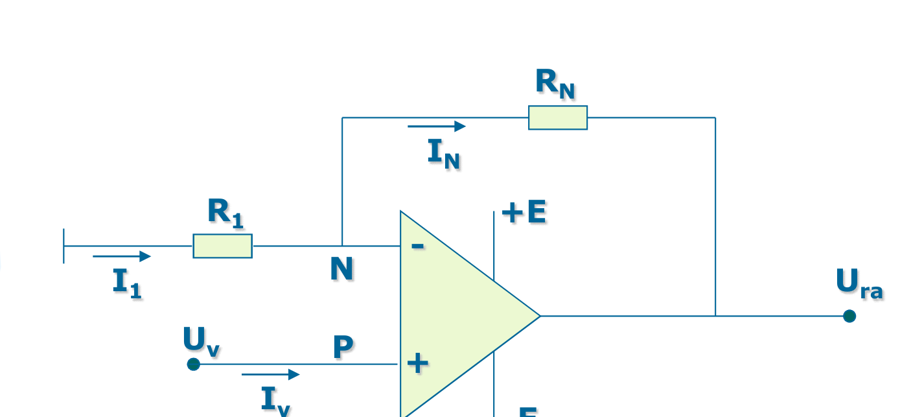
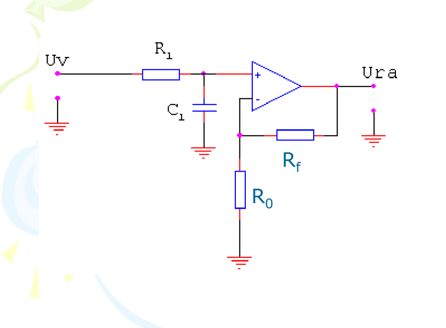
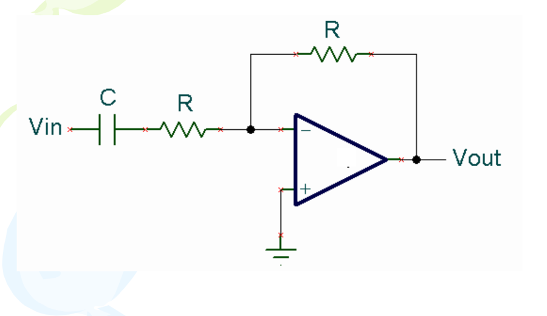
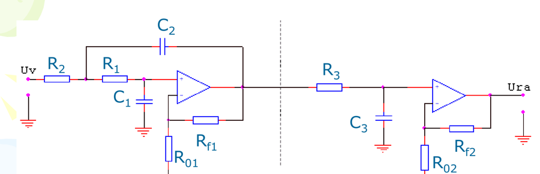
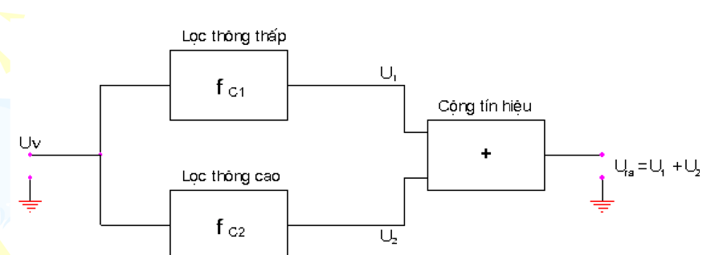
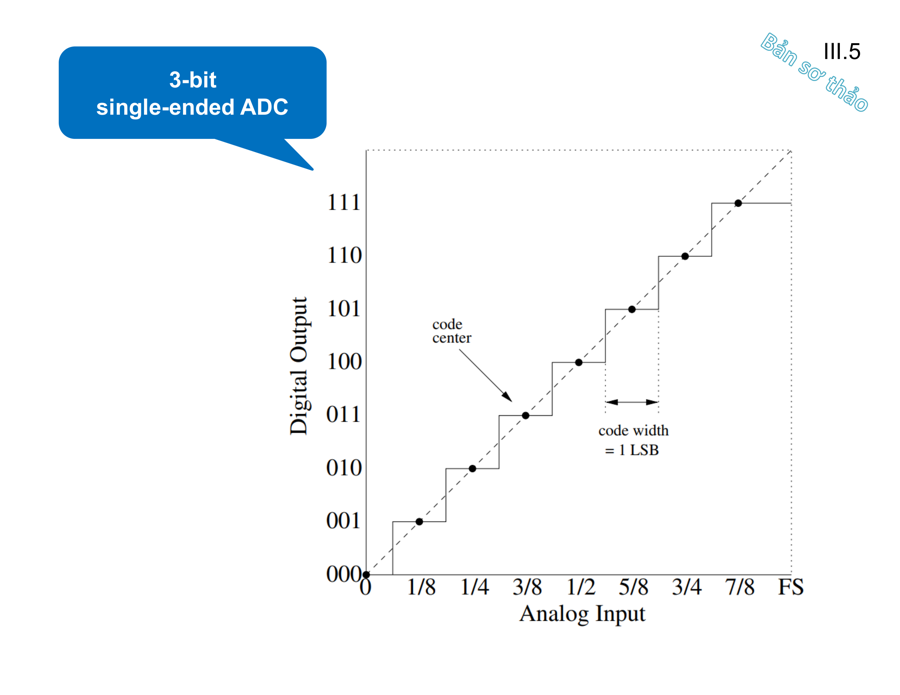
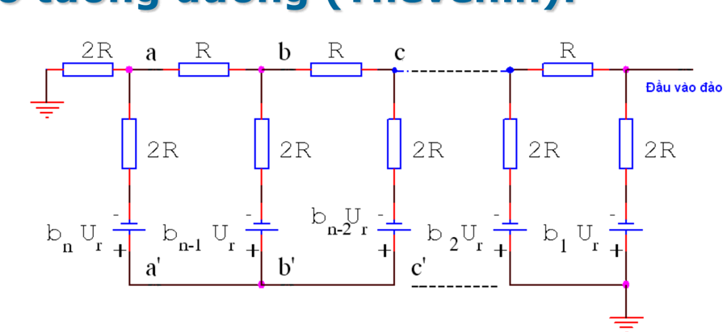

# Signals, noise and electrodes

## Which of these is an exogenous signal (applied from outside and measured after passing through the body)? {type=single id=b-exogenous tags=signals}

- [ ] ECG
- [ ] EEG
- [x] Ultrasound echo
- [ ] EMG

::: explanation
Exogenous signals are applied from outside (ultrasound, X-ray, light, current, heat) and measured after they pass through or reflect from the body. ECG, EEG and EMG are endogenous: the body generates them (bioelectric signals). Source: 2018 Ch.1; class notes on signal classes.
:::

## Which biosignal has the widest bandwidth? {type=single id=b-emg-band tags=signals}

- [ ] ECG (about 0.05–100 Hz)
- [ ] EOG (about 0.05–100 Hz)
- [ ] EEG (about 0.1–100 Hz)
- [x] EMG (about 10 Hz–2 kHz)

::: explanation
Muscle signals contain fast motor-unit spikes, so EMG reaches about 2 kHz, far wider than ECG, EOG or EEG, which all stay near or below 100 Hz. This is why EMG needs a higher sampling rate. Source: 2018 Ch.1 p15.
:::

## The EEG alpha rhythm (relaxed, eyes closed) lies in which frequency band? {type=single id=b-alpha tags=signals}

- [ ] 0–3.5 Hz
- [ ] 3.5–7.5 Hz
- [x] 7.5–13 Hz
- [ ] 13–100 Hz

::: explanation
Alpha is 7.5–13 Hz, typical of a relaxed person with eyes closed. 0–3.5 Hz is delta (deep sleep), 3.5–7.5 Hz is theta and 13 Hz upward is beta (alert). Source: 2018 Ch.1 p19–50.
:::

## The noise stays the same while the signal's RMS amplitude doubles. By how much does the SNR increase? {type=single id=b-snr-double tags=noise}

- [ ] 3 dB
- [x] 6 dB
- [ ] 2 dB
- [ ] 20 dB

::: explanation
For a voltage ratio, SNR_dB = 20·log10(U_s/U_n). Doubling U_s adds 20·log10(2) ≈ 6 dB. 3 dB is the change for doubling a power ratio, and 20 dB is a ×10 voltage change. Source: 2026 I.9–I.10.
:::

## Mains wiring running close to the ECG leads couples interference mainly through which mechanism? {type=single id=b-capacitive tags=noise}

- [x] Capacitive (electric field), because the mains voltage changes fast (large dU/dt)
- [ ] Inductive (magnetic field), because the leads carry a large current
- [ ] Conduction, because the leads share the mains supply
- [ ] Thermal noise, because the wiring heats the leads

::: explanation
A mains cable has a large, fast-changing voltage, and the stray capacitance between it and the leads injects a current: capacitive (electric-field) coupling. The fix is shielding, more spacing and a smaller facing area. Inductive coupling needs a large dI/dt (transformers, motors), and the leads carry almost no current. Source: 2026 I.11–I.13.
:::

## What is the RMS thermal noise of a 10 kΩ resistor at 300 K over a 1 kHz bandwidth ($k = 1.38\times10^{-23}$ J/K)? {type=single id=b-thermal tags=noise}

- [ ] 0.20 µV
- [ ] 4.1 µV
- [x] 0.41 µV
- [ ] 1.3 µV

::: explanation
v_n = √(4kTRB) = √(4 × 1.38×10⁻²³ × 300 × 10⁴ × 10³) ≈ 0.41 µV. Dropping the factor 4 gives 0.20 µV. 4.1 µV and 1.3 µV are off by factors of 10 and √10. Noise grows with √B, so a narrower bandwidth means less noise. Source: Northrop 9.2.
:::

## In the electrode equivalent circuit ($E_{hc}$, then $R_d \parallel C_d$, then $R_s$), what is the impedance at high frequency? {type=single id=b-electrode-hf tags=electrodes}

- [ ] $R_s + R_d$
- [x] About $R_s$
- [ ] About $R_d$
- [ ] Infinite

::: explanation
At high frequency the double-layer capacitance C_d shorts R_d, so only the gel or electrolyte resistance R_s remains. At DC the capacitor is open and the impedance is R_s + R_d, the largest value. Source: 2026 I.3–I.7; Northrop 1.8.
:::

# Op-amp fundamentals

## A real op-amp's open-loop gain is about $10^4$–$10^8$. Why is it almost always used with negative feedback? {type=single id=b-openloop tags=opamp}

- [ ] Because the open-loop gain is too small for biosignals
- [x] Because the open-loop gain is huge and varies between parts and with temperature
- [ ] Because feedback raises the input impedance to infinity
- [ ] Because without feedback the op-amp draws too much supply current

::: explanation
The open-loop gain is enormous and poorly controlled (it varies between units and with temperature), so a few µV saturate the output. Negative feedback trades that excess gain for a precise, stable gain set by resistors. The gain is far from too small, and feedback does not change the supply current. Source: 2026 V.16–V.24.
:::

## What is the input offset voltage $U_{os}$ of an op-amp? {type=single id=b-uos-def tags=opamp}

- [ ] The output voltage when both inputs are at the supply rail
- [ ] The average of the two input bias currents times the feedback resistor
- [ ] The largest input voltage before the output saturates
- [x] The input voltage that must be applied to make the output zero

::: explanation
Mismatch in the input stage means the output is not zero when the inputs are equal. U_os is the small input voltage (µV to mV) needed to bring the output back to zero. The second option describes the bias-current error, a different effect. Source: 2026 V.20–V.22.
:::

## An op-amp with $U_{os}$ = 2 mV is used in an amplifier with a gain of 100. What output error does the offset cause? {type=single id=b-uos-err tags=opamp}

- [ ] 2 mV
- [ ] 20 mV
- [x] 0.2 V
- [ ] 2 V

::: explanation
The offset is amplified like a signal: U_error = U_os × K = 2 mV × 100 = 0.2 V. 2 mV forgets the gain, and 20 mV and 2 V are off by a factor of ten. Source: 2026 V.30–V.33.
:::

## Of the ways to deal with input offset voltage, which do the slides rank best? {type=single id=b-uos-fix tags=opamp}

- [x] Choose a low-offset op-amp such as the OP07
- [ ] Use the 741's offset-null pins with a potentiometer
- [ ] Add an external potentiometer network between −E and +E
- [ ] Add a compensation resistor $R_c = R_i \parallel R_f$

::: explanation
The ranking is: (1) a low-offset op-amp (best), (2) the op-amp's offset-null pins, (3) an external trimming network (manual and drifts). R_c compensates the bias current, not the offset voltage. Source: 2026 V.30–V.33.
:::

## An ECG amplifier has $K_d$ = 1000 and CMRR = 100 dB. Its input is 1 mV of ECG plus 1 V of 50 Hz common-mode hum. How large is the hum at the output? {type=single id=b-cmrr-hum tags=cmrr}

- [ ] 1 mV
- [x] 10 mV
- [ ] 100 mV
- [ ] 1 V

::: explanation
100 dB = 10⁵, so K_c = K_d/10⁵ = 0.01. The hum at the output is 1 V × 0.01 = 10 mV, while the ECG becomes 1 mV × 1000 = 1 V. 1 V would be the hum with K_c = 1 (no rejection). Source: 2026 V.13–V.15; Northrop 3.3.
:::

## An amplifier needs a closed-loop gain of 100 and a bandwidth of 20 kHz. What is the minimum gain–bandwidth product of the op-amp? {type=single id=b-gbw-min tags=opamp}

- [ ] 200 kHz
- [ ] 5 kHz
- [ ] 20 MHz
- [x] 2 MHz

::: explanation
GBW = gain × bandwidth = 100 × 20 kHz = 2 MHz. A smaller GBW would give less than 20 kHz at a gain of 100. 200 kHz is off by ten, and 5 kHz divides instead of multiplying. Source: 2026 V.17; Northrop 6.2.
:::

## A large sine at the output of an op-amp turns into a triangle wave as the frequency rises. Which limit is reached? {type=single id=b-slew-symptom tags=opamp}

- [ ] The input offset voltage
- [x] The slew rate
- [ ] The CMRR
- [ ] The input bias current

::: explanation
The slew rate is the fastest the output can change (V/µs). When the sine needs a steeper slope than that, the output can only ramp up and down at its maximum rate, so it becomes a triangle. It sets f_max = SR/(2πV_p). Offset, CMRR and bias current cause DC or common-mode errors, not this distortion. Source: 2026 V.20–V.22.
:::

## Inside an op-amp, which stage gives it its very high input impedance? {type=single id=b-internal tags=opamp}

- [ ] The push-pull output stage
- [ ] The voltage gain stage
- [ ] The supply decoupling network
- [x] The differential input stage

::: explanation
The structure is: differential input stage (high Z_in, amplifies U_P − U_N) → voltage gain stage(s) (large K) → push-pull output (power and low Z_out). The output stage gives the low output impedance, not the high input impedance. Source: 2026 V.6–V.11.
:::

# Op-amp circuits

## Identify this circuit. {type=single id=b-id-noninv tags=opamp-circuits}

- [ ] Inverting amplifier
- [x] Non-inverting amplifier
- [ ] Difference amplifier
- [ ] Voltage follower

::: explanation
The input goes straight into the + input, and R_N with R_1 form a divider that feeds part of the output back to −. That is the non-inverting amplifier, U_out = (1 + R_N/R_1)·U_in, with very high input impedance. An inverting amplifier feeds the signal into −. A follower has no resistors. Source: 2018 Ch.2 p71; 2026 V.25.
:::

## An inverting amplifier has $R_i$ = 10 kΩ and $R_f$ = 100 kΩ. What input impedance does the signal source see? {type=single id=b-inv-zin tags=opamp-circuits}

- [x] 10 kΩ
- [ ] 100 kΩ
- [ ] 110 kΩ
- [ ] Almost infinite

::: explanation
The − input sits at virtual ground, so the source sees only R_i = 10 kΩ. That is why an inverting amplifier loads high-impedance sources such as electrodes. "Almost infinite" is the non-inverting amplifier. Source: 2026 V.26; 2018 Ch.2 p67–69.
:::

## A summing amplifier has $R_1$ = 10 kΩ, $R_2$ = 20 kΩ and $R_f$ = 20 kΩ. The inputs are $U_1$ = 0.1 V and $U_2$ = 0.4 V. What is the output? {type=single id=b-sum-weighted tags=opamp-circuits}

- [ ] −0.5 V
- [ ] −0.9 V
- [x] −0.6 V
- [ ] +0.6 V

::: explanation
U_out = −R_f(U_1/R_1 + U_2/R_2) = −(2 × 0.1 + 1 × 0.4) = −0.6 V. −0.5 V treats both weights as 1. −0.9 V swaps the two weights. +0.6 V forgets the inversion. Source: 2018 Ch.2 p70.
:::

## A difference amplifier has $R_2/R_1$ = 10. The inputs are $U_2$ = 1.002 V and $U_1$ = 1.000 V. What is the output? {type=single id=b-diff-calc tags=opamp-circuits}

- [ ] 2 mV
- [ ] 200 mV
- [x] 20 mV
- [ ] 10 V

::: explanation
U_out = (R_2/R_1)(U_2 − U_1) = 10 × 2 mV = 20 mV. The common 1 V is rejected. 10 V would amplify the common-mode level too, and 2 mV forgets the gain. Source: 2018 Ch.2 p74; 2026 V.35.
:::

## What is the main weakness of a single-op-amp difference amplifier built from discrete resistors? {type=single id=b-diff-weak tags=opamp-circuits}

- [x] Low input impedance, and a CMRR that depends on resistor matching
- [ ] It cannot reject any common-mode voltage
- [ ] Its gain is always exactly 1
- [ ] It needs three op-amps

::: explanation
The input resistors load the source (low input impedance), and a small resistor mismatch ruins the CMRR. Laser-trimmed ICs (INA132, INA146) or a buffered version, the instrumentation amplifier, fix this. It does reject common mode when matched, its gain is R_2/R_1, and it uses one op-amp. Source: 2026 V.34–V.41.
:::

## What is the main practical problem of an op-amp differentiator (C at the input, R in the feedback)? {type=single id=b-differentiator tags=opamp-circuits}

- [ ] It drifts into saturation because of its unlimited DC gain
- [ ] It cannot block DC
- [x] It amplifies high-frequency noise and can oscillate
- [ ] It inverts only DC signals

::: explanation
Its gain rises at +20 dB/decade, so high-frequency noise is amplified most, and it can oscillate. A small resistor in series with C limits the high-frequency gain. Unlimited DC gain and drift are the integrator's problem. A differentiator blocks DC. Source: Northrop 6.1.
:::

## An integrator has R = 10 kΩ and C = 1 µF. A constant +1 V is applied. How fast does the output change? {type=single id=b-integrator tags=opamp-circuits}

- [ ] −10 V/s
- [ ] +100 V/s
- [ ] −1000 V/s
- [x] −100 V/s

::: explanation
dU_out/dt = −U_in/(RC) = −1 V / (10⁴ Ω × 10⁻⁶ F) = −100 V/s. The output ramps down until it saturates. The sign is negative because the integrator is inverting. Source: Northrop 6.1; 2018 Ch.2 p66.
:::

## A circuit's ideal gain is $K' = 100$, but the op-amp's open-loop gain is only $K_0 = 1000$. Using $\frac{1}{K} = \frac{1}{K_0} + \frac{1}{K'}$, what is the real gain? {type=single id=b-finite-k tags=opamp-circuits}

- [ ] 100
- [x] 90.9
- [ ] 1100
- [ ] 9.1

::: explanation
1/K = 1/1000 + 1/100 = 0.011, so K ≈ 90.9. A finite open-loop gain always makes the real gain a little smaller than the ideal one. 1100 adds the gains, and 9.1 inverts the result wrongly. Source: 2026 V.25–V.26.
:::

# Comparators, bio-amplifiers and safety

## Why is hysteresis (a Schmitt trigger) added to a comparator? {type=single id=b-hysteresis tags=comparator}

- [ ] To make the comparator respond faster
- [x] To stop noise near the threshold from making the output toggle many times
- [ ] To give the comparator a linear output
- [ ] To raise the comparator's input impedance

::: explanation
Without hysteresis, a noisy signal close to the threshold crosses it many times and the output "chatters". Positive feedback creates two thresholds, so noise smaller than the gap cannot flip the output. It does not make the comparator linear or faster. Source: Northrop 6.5.
:::

## How is a comparator used to measure heart rate from an ECG? {type=single id=b-rpeak tags=comparator}

- [x] It compares the filtered ECG with a threshold and gives one pulse per QRS complex
- [ ] It amplifies the ECG so the P wave becomes visible
- [ ] It removes the 50 Hz hum before the ADC
- [ ] It converts the ECG into a 12-bit digital code

::: explanation
The R wave is the tallest, steepest part of the ECG. A comparator set above the other waves gives one output pulse per QRS, and counting those pulses gives the heart rate. A comparator outputs only high or low, so it does not amplify, filter or give multi-bit codes. Source: Northrop 6.5; class notes.
:::

## An INA129 instrumentation amplifier has gain $G = 1 + 49.4\ \mathrm{k\Omega}/R_G$. Which $R_G$ gives G = 100? {type=single id=b-ina129 tags=ia}

- [ ] 4.99 kΩ
- [ ] 49.4 Ω
- [x] 499 Ω
- [ ] 1 kΩ

::: explanation
R_G = 49.4 kΩ / (G − 1) = 49.4 kΩ / 99 ≈ 499 Ω. 1 kΩ gives about 50. 4.99 kΩ gives about 11. 49.4 Ω divides by 1000 instead of 99. Smaller R_G means higher gain. Source: 2026 V.44.
:::

## In a 3-op-amp instrumentation amplifier, where is the common-mode signal removed? {type=single id=b-ia-cm tags=ia}

- [ ] In the gain resistor $R_G$
- [ ] In the two input buffers, which have a common-mode gain of zero
- [x] In the output difference stage; the input stages pass it with gain 1
- [ ] In the right-leg electrode only

::: explanation
The two input stages amplify the difference by (1 + 2R_1/R_G) but pass the common mode with gain 1, since no current flows through R_G for a common voltage. The difference stage (A3) then subtracts the two outputs and rejects it. A right-leg drive helps further, but it is not where the IA itself rejects the common mode. Source: 2026 V.42–V.43; Northrop 8.2.
:::

## Why can't the first stage of an ECG instrumentation amplifier have a very high gain? {type=single id=b-ia-dc tags=ia}

- [x] The electrode DC offset (up to ±300 mV) would saturate it
- [ ] A high gain would lower the CMRR to zero
- [ ] The ECG is already too large for a high gain
- [ ] A high gain would make the input impedance too low

::: explanation
The half-cell potentials leave up to ±300 mV of DC between the electrodes. A gain of, say, 100 would demand ±30 V at the output and saturate it. So the first stage has a modest gain, the DC is removed by a high-pass, and more gain follows. Higher IA gain usually improves CMRR, and the ECG is only about 1 mV. Source: 2026 V.2–V.5; Northrop 8.2.
:::

## Under IEC 60601-1, what is the patient leakage-current limit? {type=single id=b-iec tags=safety}

- [ ] 500 µA
- [ ] 1 mA
- [ ] 300 µA
- [x] 50 µA

::: explanation
IEC 60601-1 allows 50 µA of patient leakage (UL544 allows only 10 µA). 500 µA is the IEC enclosure (chassis) limit, 1 mA the IEC ground limit, and 300 µA the UL chassis and ground limit. The patient limit is the tightest because of microshock risk. Source: 2018 Ch.3 p86–88; Northrop 8.4.
:::

## Which type of isolation barrier can carry power across as well as the signal? {type=single id=b-iso-power tags=safety}

- [ ] Optical (LED and photodiode)
- [x] Magnetic (transformer)
- [ ] Thermal
- [ ] A high-value resistor

::: explanation
A transformer barrier passes a modulated carrier and can also transfer power, which is how isolated DC-DC converters work. An optical barrier carries only the signal (light). A resistor is a conductive path, so it is not an isolation barrier. Source: 2018 Ch.3 p89–95; Northrop 8.3.
:::

# Analog filters

## For this filter, what sets the cutoff frequency and the passband gain? {type=single id=b-id-bw1 tags=filters}

- [ ] $f_c = 1/(2\pi R_f C_1)$ and $K = -R_f/R_0$
- [ ] $f_c = 1/(2\pi R_0 C_1)$ and $K = R_f/R_0$
- [x] $f_c = 1/(2\pi R_1 C_1)$ and $K = 1 + R_f/R_0$
- [ ] $f_c = 1/(2\pi R_1 R_f C_1)$ and $K = 1$

::: explanation
This is a 1-pole Butterworth low-pass: the R_1–C_1 section sets f_c = 1/(2πR_1C_1), and the non-inverting stage gives K = 1 + R_f/R_0. The op-amp also buffers the RC so a load cannot change f_c. A negative gain would need the inverting input. Source: 2018 Ch.4 p13.
:::

## What is the gain of this circuit as the frequency approaches zero? {type=single id=b-id-hp tags=filters}

- [x] Zero
- [ ] $-1$
- [ ] Infinite
- [ ] $+1$

::: explanation
At f = 0 the series capacitor is an open circuit, so no current reaches the − input and the output is zero. At high frequency C is a short and the gain is −R/R = −1. That makes it a 1-pole high-pass, with f_c = 1/(2πRC). Source: 2018 Ch.4 p17.
:::

## This filter is a 2-pole stage followed by a 1-pole stage with the same cutoff. What is its roll-off above $f_c$? {type=single id=b-id-3pole tags=filters}

- [ ] −20 dB/decade
- [ ] −40 dB/decade
- [x] −60 dB/decade
- [ ] −120 dB/decade

::: explanation
The total order is 2 + 1 = 3 poles, and each pole adds −20 dB/decade, so the slope is −60 dB/decade (−18 dB/octave). The stages are given the same f_c so the poles act together at one cutoff. −120 dB/decade multiplies the orders instead of adding them. Source: 2018 Ch.4 p15.
:::

## In this block diagram, $f_{c1}$ belongs to the low-pass and $f_{c2}$ to the high-pass, and the outputs are added. With $f_{c2} > f_{c1}$, what filter results? {type=single id=b-id-parallel tags=filters}

- [ ] Band-pass
- [x] Band-stop (notch)
- [ ] All-pass
- [ ] A 2-pole low-pass

::: explanation
The low-pass keeps everything below f_c1 and the high-pass everything above f_c2. Added together they pass everything except the gap between f_c1 and f_c2, which is a band-stop. A band-pass puts the two filters in series instead. Source: 2018 Ch.4 p26–29.
:::

## Which is an advantage of a passive RC filter over an active filter? {type=single id=b-passive tags=filters}

- [ ] It can give a gain above 1
- [ ] Its output impedance is very low, so loading does not matter
- [x] It needs no power supply and works at high frequency and high power
- [ ] It has a sharper roll-off per section

::: explanation
A passive RC filter needs no supply, is always stable and is not limited by an op-amp's GBW. But its gain is at most 1, the load changes its response, and each section gives only −20 dB/decade. Gain, low output impedance and sharp roll-off are the advantages of active filters. Source: 2018 Ch.4 p8–10; AD 8.1–8.2.
:::

## A design needs the sharpest possible cutoff from a given order, and some passband ripple is acceptable. Which approximation fits? {type=single id=b-chebyshev tags=filters}

- [ ] Butterworth
- [ ] Bessel
- [x] Chebyshev
- [ ] A passive RC cascade

::: explanation
Chebyshev trades passband ripple for the steepest roll-off of the three classic types. Butterworth is flat with a medium slope. Bessel is the slowest but keeps pulse shape. A passive RC cascade has a gentle, rounded knee. Source: 2018 Ch.4 p30–33; AD 8.4.
:::

## A band-pass filter has a centre frequency of 1 kHz and a bandwidth of 100 Hz. What is its quality factor Q? {type=single id=b-bp-q tags=filters}

- [ ] 0.1
- [ ] 100
- [ ] 1
- [x] 10

::: explanation
Q = f_0/B = 1000/100 = 10. Because Q ≥ 2 (narrow band), the edges are about f_0 ∓ B/2, so roughly 950–1050 Hz. 0.1 inverts the ratio. Source: 2018 Ch.4 p20–25.
:::

## What is the phase shift of a 1-pole RC low-pass at its cutoff frequency? {type=single id=b-phase tags=filters}

- [x] −45°
- [ ] −90°
- [ ] −180°
- [ ] 0°

::: explanation
At f = f_c the RC low-pass has K = 1/(1 + j), so the magnitude is 0.707 (−3 dB) and the phase is −45°. It approaches −90° only far above f_c. Source: 2018 Ch.4 p8–9.
:::

## An equal-R, equal-C Sallen-Key low-pass has a non-inverting gain K = 2. What is its Q? {type=single id=b-sk-q tags=filters}

- [ ] 0.5
- [ ] 0.707
- [x] 1
- [ ] 2

::: explanation
With equal parts, Q = 1/(3 − K) = 1/(3 − 2) = 1. That is above the Butterworth value of 0.707, so the response peaks a little (Chebyshev-like). K = 1.586 would give 0.707, and K = 3 would make it oscillate. Source: 2018 Ch.4 p34–37; AD 8.6.
:::

# ADC and DAC

## The figure shows an ideal 3-bit ADC. If its full scale is 2 V, what is 1 LSB? {type=single id=b-adc3 tags=adc}

- [x] 0.25 V
- [ ] 0.286 V
- [ ] 0.667 V
- [ ] 0.125 V

::: explanation
A 3-bit ADC has 2³ = 8 codes, and each code is 1 LSB = FS/2^N = 2 V/8 = 0.25 V wide. 0.286 V divides by 7 (the top code), 0.667 V divides by the 3 bits, and 0.125 V divides by 16. Source: 2026 III.5.
:::

## An ADC has a 5 V input range and must resolve steps of 1 mV or less. What is the minimum number of bits? {type=single id=b-adc-bits tags=adc}

- [ ] 10
- [ ] 12
- [x] 13
- [ ] 16

::: explanation
It needs 2^N ≥ 5 V / 1 mV = 5000. 2¹² = 4096 is too few (1.22 mV steps), while 2¹³ = 8192 gives 0.61 mV, so N = 13. 16 bits would work but is not the minimum. Source: 2026 III.4–III.8.
:::

## About how many clock cycles does a 12-bit SAR ADC need for one conversion? {type=single id=b-sar tags=adc}

- [ ] 1
- [x] 12
- [ ] 4096
- [ ] 4095

::: explanation
A SAR ADC does a binary search, deciding one bit per clock from the MSB down, so N bits take about N clocks. 1 clock is the flash ADC. 4095 would be the number of comparators a 12-bit flash ADC needs. Source: 2026 III.4, III.7.
:::

## The sample-and-hold of a 12-bit ADC charges with a time constant τ = 2 µs. What minimum sampling time does it need? {type=single id=b-settle tags=adc}

- [ ] 2 µs
- [ ] 8.3 µs
- [ ] 24 µs
- [x] 16.6 µs

::: explanation
To settle within ½ LSB the capacitor needs t ≥ N·ln2·τ ≈ 8.3τ for 12 bits, so 8.3 × 2 µs ≈ 16.6 µs. 8.3 µs is the value for τ = 1 µs. 24 µs uses 12τ. A higher source impedance raises τ, so it needs a longer sampling time or a buffer. Source: 2026 III.26–III.29.
:::

## A 12-bit ADC is used with oversampling and averaging to reach 14 effective bits. By how much must the sampling rate rise? {type=single id=b-oversample tags=adc}

- [ ] 2×
- [ ] 4×
- [x] 16×
- [ ] 64×

::: explanation
Each extra bit needs 4× oversampling, so 2 extra bits need 4 × 4 = 16×. It only works if there is some noise (dither) on the input. 4× gives one bit, and 64× would give three. Source: 2026 III.30–III.38.
:::

## An ADC's output is shifted by a constant amount at all inputs, mattering most for small inputs. Which error is this, and how is it corrected? {type=single id=b-offset-err tags=adc}

- [ ] Gain error; corrected by scaling the codes
- [ ] INL; corrected with a lookup table
- [ ] DNL; corrected only by a better ADC
- [x] Offset error; corrected by subtracting a constant

::: explanation
A constant shift is the offset (zero-scale) error. It is easy to calibrate out in software by subtracting it. Gain error is a slope mismatch (largest at full scale) and is fixed by scaling. INL is curve bending (lookup table), and DNL is uneven step widths. Source: 2026 III.13–III.21.
:::

## What is the main advantage of this DAC network over the weighted-resistor DAC? {type=single id=b-id-r2r tags=dac}

- [ ] It needs fewer resistors
- [x] It uses only two resistor values, R and 2R, which are easy to match
- [ ] It needs no op-amp at the output
- [ ] It converts faster because it has no switches

::: explanation
This is the R-2R ladder. Each node halves the contribution of the next bit, so binary weighting comes from only two values, R and 2R, which are easy to make and trim accurately. A weighted-resistor DAC needs values spread over 2^(n−1). The ladder actually uses more resistors (about 2n), and it still has switches and usually an output op-amp. Source: 2026 III.44–III.47; 2018 Ch.5 p6–12.
:::

## A microcontroller makes a DAC from a 3.3 V PWM signal with a 30 % duty cycle and an RC low-pass. What is the output voltage? {type=single id=b-pwm tags=dac}

- [ ] 2.31 V
- [ ] 0.30 V
- [x] 0.99 V
- [ ] 1.65 V

::: explanation
The RC filter keeps the average: V_out = D × V_dd = 0.3 × 3.3 V = 0.99 V. 2.31 V uses the off-time (70 %), and 1.65 V is a 50 % duty cycle. The filter's f_3dB must be far below the PWM frequency to keep the ripple small. Source: 2026 III.48.
:::

# Power sources

## A divider bias uses $R_A = R_B$ = 100 kΩ with a bypass capacitor $C_2$ = 1 µF at the tap. What is the corner frequency of this filter? {type=single id=b-bypass tags=power}

- [x] 3.2 Hz
- [ ] 1.6 Hz
- [ ] 0.32 Hz
- [ ] 31.8 Hz

::: explanation
The capacitor sees R_A ∥ R_B = 50 kΩ, so f = 1/(2π × 50 kΩ × 1 µF) ≈ 3.2 Hz. 1.6 Hz uses 100 kΩ instead of the parallel value. Below this frequency, supply noise still reaches the bias, so it should be at most a tenth of the input bandwidth. Source: AN-581 p1–3.
:::

## What is the main drawback of using a Zener diode as the mid-supply reference for a single-supply op-amp? {type=single id=b-zener-drawback tags=power}

- [ ] It gives no supply rejection, so supply noise passes to the bias
- [ ] Its output follows the supply exactly, like a divider would
- [ ] It cannot source or sink any current into the next stage
- [x] It stays at $V_Z$, not $V_S/2$, so clipping turns asymmetric

::: explanation
A Zener holds a fixed V_Z regardless of the supply, which restores supply rejection. But when the supply drops (a battery discharging), V_Z no longer sits in the middle, so the signal clips on one side first. It also uses more power and is noisy, so it needs a capacitor C_N. Source: AN-581 p4–5.
:::

## How are supply bypass (decoupling) capacitors usually placed for an op-amp? {type=single id=b-decoupling tags=power}

- [ ] One large electrolytic (about 1000 µF) at the regulator output only
- [x] A 0.1 µF ceramic plus a 1–10 µF electrolytic, close to each IC's pins
- [ ] A single 1 pF capacitor in series with each supply pin of the IC
- [ ] A capacitor from each op-amp input to ground, sized for the signal

::: explanation
The ceramic handles high-frequency noise and the electrolytic low-frequency ripple, and both must sit close to the IC pins to work. Capacitors only at the regulator leave long traces in between. A series capacitor would block the DC supply. Without decoupling, ripple can feed back and cause "motor-boating" (low-frequency oscillation). Source: AN-581 p1–3.
:::

## In an isolated ECG module, how do the digitised samples reach the main processor? {type=single id=b-iso-data tags=power}

- [ ] Through a shared ground wire with the mains-side system
- [ ] Through a resistor divider across the barrier
- [ ] Through the isolated DC-DC converter's output
- [x] Through a digital isolator or optocoupler across the barrier

::: explanation
Power crosses the barrier through an isolated DC-DC converter, and data crosses separately through a digital isolator (or optocoupler). Nothing conductive joins the two sides. A shared ground or a resistor would bridge the barrier and defeat the isolation. Source: TI SLOA285A; Northrop 8.5.
:::
